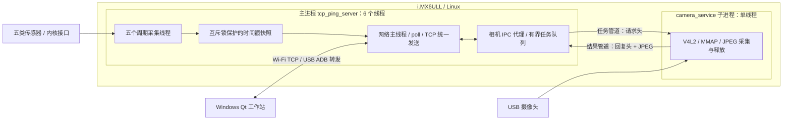

# 基于 i.MX6ULL 与 Qt 的厂区巡检辅助监测终端

面向厂区室内低速巡检设备的辅助观察与停靠监测，基于正点原子 ALPHA V2.8 开发板，实现五类传感器采集、图像传输及 Windows Qt 工作站显示。巡检时通过局域网查看环境、姿态原始数据、距离和画面；停靠时由活动信号触发预览，连续有效低电平至少 10 秒后关闭画面并继续监测。

**当前架构：网络与采集主进程 + 独立相机子进程 + 双匿名管道 IPC。** 主进程保留网络主线程和五个采集线程，相机子进程按客户端连接创建与回收。当前是监测交互原型，尚未在实际厂区部署，不承担运动控制或安全制动。

| 版本入口 | 架构与状态 |
| --- | --- |
| 默认分支 [`main`](https://github.com/anyway-sc/imx6ull-inspection-terminal/tree/main) | 当前相机进程隔离与双匿名管道集成版；主机回归已通过，ARM 正式链接与板端验证范围见下文 |
| [`feat/camera-process-isolation`](https://github.com/anyway-sc/imx6ull-inspection-terminal/tree/feat/camera-process-isolation) | 对应功能开发分支，保留改造过程与提交记录 |

当前代码与文档统一从默认分支 `main` 查看。相机进程隔离与双管道改造记录见 [PR #2](https://github.com/anyway-sc/imx6ull-inspection-terminal/pull/2)。

**技术栈：** C / C++17、Linux 4.1.15、pthread、posix_spawn、匿名管道 / poll、Qt 6.8.3、TCP Socket、V4L2 / MMAP、SPI / GPIO / sysfs、设备树 / pinctrl、ARM 交叉编译、SysV init。

项目基于参考实现完成驱动适配、代码改造、集成与排障，来源见 [NOTICE.md](NOTICE.md)。

## 业务功能

| 模块 | 实现 |
| --- | --- |
| 多传感器采集 | AP3216C 原始计数、ICM20608 六轴及温度、DHT11 温湿度、SR04 距离、SR501 活动电平 |
| 图像观察 | V4L2 采集 640×480 MJPEG，支持拍照、Qt 解码显示、手动保存与按请求连续预览 |
| 距离与图像联合观察 | 用户手动开启测距与预览，在同一页面观察距离和画面；测距失败后继续尝试恢复 |
| 停靠活动监测 | SR501 高电平开启画面；连续有效低电平至少 10 秒后停止取帧，继续监测后续活动 |
| 故障处理 | 相机用户态故障后清理未完成图像并有限重启；完整相机错误回复保留 TCP 与传感器业务 |
| 连接与启动 | Wi-Fi 局域网 TCP 直连或 USB/ADB 转发，前台启动检查与可选 SysV 服务入口 |

Qt 现有界面沿用参考方案的“倒车”和“哨兵”页面名称。高电平、未知、过期或错误会清除低电平累计；倒计时由独立定时器刷新，关闭画面的判断仍依赖有效低电平回复。

## 架构与方案理由



| 业务约束 | 选择与理由 |
| --- | --- |
| 不同设备读取耗时不同，网络需持续响应 | 五个线程后台采样；网络线程读取最新有效快照，避免每条请求都现场等待设备采样 |
| 相机涉及驱动调用、设备映射和图像内存 | 将相机独立为子进程，隔离其用户态崩溃并支持单独重建；单核 i.MX6ULL 上拆进程不增加 CPU 算力 |
| 单个父进程管理单个相机子进程 | 两根匿名管道分别传任务和结果，由 `posix_spawn` 映射端点；无需额外服务地址，通信关系与进程生命周期一致 |
| JPEG 长度可变，突发请求与慢接收会积压 | 使用长度头、非阻塞 IPC、有界队列和超时；父进程收齐并校验完整图像后统一发送 TCP |
| 移动巡检需远程观察，开发时需稳定调试入口 | 应用侧使用局域网 TCP，Wi-Fi 提供无线接入；USB/ADB 提供开发调试转发，两种链路复用同一应用协议 |

### 采集与资源管理

- **传感器快照：** 设备 I/O 在缓存锁外执行，完成后加锁发布完整样本、错误状态和单调时间戳；请求校验最新读取状态及快照有效期。DHT11 与 SR04 共用时序互斥锁，协调本服务内的采样。
- **进程生命周期：** 主进程始终为网络主线程加五个采集线程。客户端连接后以 `posix_spawn()` 创建相机子进程，断线后关闭 IPC、停止并回收子进程；`camera_worker.c` 是主线程内的代理，不再创建相机线程。
- **管道分帧：** 使用两次 `pipe2(O_CLOEXEC | O_NONBLOCK)`，子进程 FD 3 读任务、FD 4 写结果。消息采用 40 字节大端头，校验连接代号、进程代次、请求号及载荷长度；通过 `poll()` 和偏移状态处理短读短写、背压、EOF/EPIPE，显式忽略 SIGPIPE。
- **有界任务与图像归属：** 最多四项待执行任务、一项在途任务和一项完整回复，排队已满返回 `CAMERA_BUSY`。子进程独占 V4L2 和最多四块 MMAP 缓冲；父子进程分别管理自己的 JPEG 内存，发送完成、失败或断线时释放。
- **恢复与退出：** 启动握手限时 3 秒，任务限时 10 秒；每连接允许初次启动加最多两次重启，间隔至少 500 ms。主服务处理 SIGINT/SIGTERM，唤醒并回收采集线程，终止相机子进程并以 `waitpid()` 回收。

完整线程同步、FD 归属、消息格式和恢复策略见 [架构说明](docs/architecture.md)。

### 通信与界面

对外仍使用单条 TCP 连接：文本按 LF 分行，JPEG 按长度读取，请求编号匹配回复。Qt 使用 `QTcpSocket::readyRead` 和接收缓存处理分段或合并到达的数据，通过信号槽、`QTimer` 与状态变量协调采样、预览、跨页交接及倒计时。

预览按请求逐帧获取，完整显示后再安排下一次请求。慢客户端仍可能推迟后续回复，后台传感器采样继续进行；当前没有实测帧率或延迟承诺。协议与错误处理见 [protocol.md](docs/protocol.md)。

## 代码入口

```text
client/       Windows Qt 上位机：显示、协议接收和场景联动
server/       板端主服务、采集线程、IPC 与独立相机服务
drivers/      ICM20608、DHT11、SR04 外置内核模块
device-tree/  SR501 最终 GPIO1 方案参考补丁
scripts/      双程序构建、源码测试包、前台检查与 SysV 入口
tests/        Qt 业务、采集同步、网络、进程与管道检查
docs/         架构、硬件、协议、构建部署及验证记录
```

| 关键文件 | 职责 |
| --- | --- |
| [`server/tcp_ping_server.c`](server/tcp_ping_server.c) | TCP 主循环、命令解析、统一发送和信号通知处理 |
| [`server/sensor_sampler.c`](server/sensor_sampler.c) | 五路采样、缓存时效、线程创建失败回滚与退出回收 |
| [`server/camera_worker.c`](server/camera_worker.c) | 主线程内相机代理、任务排队、IPC 收发、完整图像校验和恢复状态 |
| [`server/process_manager.c`](server/process_manager.c) | 管道创建、`posix_spawn`、FD 映射与关闭、子进程停止和回收 |
| [`server/ipc_protocol.c`](server/ipc_protocol.c) | 进程间消息头编解码 |
| [`server/camera_service.c`](server/camera_service.c) | 相机子进程入口与串行任务执行 |
| [`server/camera_capture.c`](server/camera_capture.c) | V4L2 初始化、MMAP、取帧及相机资源释放 |

## 构建与运行入口

### Ubuntu 交叉编译板端双程序

在仓库根目录执行，工具链需与目标 ARM hard-float ABI 和板端运行库匹配：

```sh
sh scripts/build-on-ubuntu.sh
```

编译器不在 PATH 中时，将完整路径作为第一个参数传入。脚本生成：

```text
build-arm/tcp_ping_server_mp
build-arm/camera_service
build-arm/build-manifest.txt
```

两个可执行文件必须来自同次构建并成对部署。默认将 `camera_service` 放在主程序同目录，也可通过 `VEHICLE_CAMERA_SERVICE` 指定其绝对路径。先核对两个 ELF 的 ABI、动态加载器和库依赖，再按 [管道版板端验收](docs/process-board-test.md) 在独立目录试运行；仓库源码更新不会自动替换板端开机程序。

### Linux 主机模拟回归

无需 Qt 和真实传感器，可构建服务及模拟程序：

```sh
cmake -S . -B build-server -DVEHICLE_BUILD_CLIENT=OFF -DBUILD_TESTING=ON
cmake --build build-server --parallel 2
ctest --test-dir build-server --output-on-failure
```

Linux 此配置包含八项非 Qt CTest，检查采样同步、网络分帧、进程隔离、管道错误与资源回收；模拟网络检查要求本机 9000 端口空闲。Windows Qt 构建、十一项 CTest 和额外检查见 [构建说明](docs/build.md) 与 [测试说明](tests/README.md)。主机产物不能直接上传到 ARM 板。

### Qt 连接与板端启动

1. 按 [硬件与接口](docs/hardware.md) 核对板型、接线、驱动和设备树。
2. 按 [构建说明](docs/build.md) 编译 Qt；建议使用纯英文工程路径。
3. 按 [部署说明](docs/deployment.md) 启动板端服务。首次升级使用独立测试目录，保留旧程序与恢复入口。
4. Qt 默认连接 `127.0.0.1:19000`，用于 ADB 转发；Windows 执行下面的命令，序列号按 `adb devices` 实际结果替换：

   ```powershell
   adb -s vehicle-stage02 forward tcp:19000 tcp:9000
   ```

5. Wi-Fi 直连时改用开发板当前 IPv4 和 9000 端口，具体修改位置见构建说明。连接后先确认 `PING/PONG`，再启用采集和图像业务。

SysV 包装入口依赖板端现有的 `start-usb-adb.sh`，该脚本未纳入仓库；仓库不提供通用的一键安装或自动联网流程，缺少配套环境时先使用前台启动入口。

## 验证状态与限制

| 范围 | 已有证据与待办 |
| --- | --- |
| 当前管道版主机回归 | 源码基线 `c72e1e2` 的 Windows 11/11、Linux 8/8 CTest 通过，见 [Actions 记录](https://github.com/anyway-sc/imx6ull-inspection-terminal/actions/runs/44514391758) |
| 当前管道版 ARM 静态检查 | 十二个正式 C 文件的 ARM 目标语法与 Clang core/unix 分析通过；没有执行正式 ARM 链接 |
| 当前管道版实机验收 | 匹配工具链链接、五路设备与相机、故障恢复、父子进程资源和场景联动仍需重新验收 |
| 此前多线程版实机 | 已完成 ARM 构建、采集、拍照预览、十次取图重连、队列满回复与 SIGTERM 退出；这些结果仅属于旧版 |
| Qt 倒计时 | 独立显示刷新修复已完成本机回归及人工实机复测 |

当前只处理一个客户端，断线后需要手动重连。相机子进程隔离针对用户态故障；不可中断的内核驱动等待仍可能阻碍回收，主进程本身没有崩溃自动拉起机制。传感器不是硬件同步采样，读取成功不代表完成精度校准；CPU、两进程总 RSS、端到端延迟、集成帧率和长期稳定性尚未量化。

详细环境、历史实机证据与未覆盖范围见 [验证记录](docs/validation.md)。后续提交的 CI 以对应提交的 [Actions](https://github.com/anyway-sc/imx6ull-inspection-terminal/actions) 结果为准。

## 开发与资料

- [开发与提交规范](CONTRIBUTING.md)：分支、提交、检查和 PR 流程。
- [工程变更记录](CHANGELOG.md)：单线程、多线程、相机进程隔离及管道 IPC 的演进。
- [Git 工作流记录](docs/git-workflow.md) 与 [功能模块集成复盘](docs/module-replay.md)：实际分支与集成记录；模块复盘针对多线程改造前的版本。
- [源码整理摘要](docs/source-manifest.json)：2026-11-17 的原始整理基线，摘要不代表后续修改后的文件。
