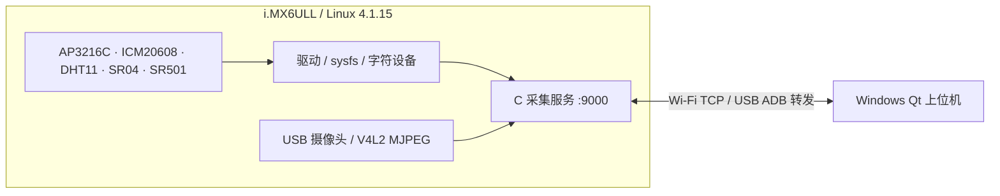

# i.MX6ULL Linux 采集与 Qt 智能车载终端

基于正点原子 ALPHA V2.8 开发板，将 Linux 设备采集、TCP 请求应答和 Windows Qt 上位机集成为一套可运行的学习项目，支持环境监测、摄像头预览与拍照、倒车监测及人体活动触发的哨兵画面。

**技术栈：** C / C++17 / Linux 4.1.15 / Qt 6.8.3 / TCP / V4L2 / SPI / GPIO / sysfs / SysV init。

项目基于参考实现完成适配、修改、集成、构建部署和实机排障，来源见 [NOTICE.md](NOTICE.md)。功能与验证范围见 [验证记录](docs/validation.md)。

## 功能

| 模块 | 当前实现 |
| --- | --- |
| 环境与板载传感器 | DHT11 温湿度首页，AP3216C 原始计数，ICM20608 六轴及温度读取 |
| 摄像头 | V4L2/MJPEG、640×480、单帧拍照、TCP JPEG 连续预览、手动保存 |
| 倒车监测 | HC-SR04-RC 测距与相机画面联合展示，读取失败后继续尝试恢复 |
| 哨兵监测 | HC-SR501 高电平开启画面，连续有效低电平至少 10 秒后停止取帧 |
| 通信与启动 | Wi-Fi TCP 直连或 USB/ADB 端口转发，启动条件检查，SysV 服务管理 |

## 系统结构



板端在一个进程、一个线程内顺序处理当前客户端；Qt 使用 `QTcpSocket::readyRead`、`QTimer` 和接收缓存协调业务。文本按 LF 分行，JPEG 按长度读取。

## 目录

```text
client/       实际 VehiclePanel Qt 工程的整理副本
server/       七个 C 源文件组成的板端 TCP 服务
drivers/      ICM20608、DHT11、SR04 外置内核模块源码
device-tree/  SR501 最终 GPIO1 方案参考补丁
scripts/      前台启动检查与 SysV 服务入口
tests/        Qt 模拟、文本解析、驱动纯逻辑和启动脚本检查
docs/         架构、构建、接线、协议、部署和验证说明
```

## 从哪里开始

1. 按 [构建说明](docs/build.md) 编译 Qt 客户端；默认连接 `127.0.0.1:19000`，适用于 ADB 转发。
2. 按 [硬件与接口](docs/hardware.md) 核对板型、接线、驱动和设备树，再交叉编译服务及内核模块。
3. 按 [部署说明](docs/deployment.md) 启动服务，建立 Wi-Fi 直连或 ADB 转发。
4. 先确认 `PING/PONG`，再使用传感器、相机、倒车和哨兵页面。

详细协议见 [protocol.md](docs/protocol.md)，现有测试见 [tests/README.md](tests/README.md)。

## 开发与版本管理

后续迭代按 [开发与提交规范](CONTRIBUTING.md) 使用工作分支、独立目的提交和验证后合并。仓库提供 PR 与 Issue 模板，用于记录修改原因、环境和验证结果。

## 当前边界

当前只接待一个客户端，连接中断后需手动重连。Wi-Fi 地址可能变化，仓库副本恢复为本地转发默认值；直连时按构建说明修改目标地址及显示。精确集成帧率、端到端延时和长期内存稳定性尚未完成量化，旧独立采集练习的数据不作为本系统指标。

仓库快照日期：2026-11-17。源码整理来源及原始文件摘要见 [source-manifest.json](docs/source-manifest.json)。
