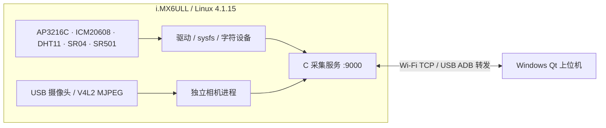

# 基于 i.MX6ULL 与 Qt 的厂区巡检辅助监测终端

面向厂区室内低速巡检设备的辅助观察与停靠监测，基于正点原子 ALPHA V2.8 开发板构建 Linux 采集服务与 Windows Qt 工作站协作的监测原型，通过局域网提供环境与惯性数据、距离与图像联合观察及活动触发预览。

巡检时由工作站通过 Wi-Fi 连接板端服务，接收移动设备传回的数据和画面；停靠时以活动信号触发预览，连续有效低电平至少 10 秒后关闭画面。现有界面沿用原参考方案的“倒车”和“哨兵”页面名称。当前完成的是监测与交互原型，未在实际厂区部署，也不承担车辆运动控制或安全制动。

**技术栈：** C / C++17 / Linux 4.1.15 / pthread / Qt 6.8.3 / TCP / V4L2 / SPI / GPIO / sysfs / SysV init。

项目基于参考实现完成适配、修改、集成、构建部署和实机排障，来源见 [NOTICE.md](NOTICE.md)。功能与验证范围见 [验证记录](docs/validation.md)。

## 功能

| 模块 | 当前实现 |
| --- | --- |
| 环境与板载传感器 | DHT11 温湿度首页，AP3216C 原始计数，ICM20608 六轴及温度读取 |
| 摄像头 | V4L2/MJPEG、640×480、单帧拍照、TCP JPEG 连续预览、手动保存 |
| 距离与图像联合观察 | HC-SR04-RC 测距与相机画面联合展示，读取失败后继续尝试恢复 |
| 停靠活动监测 | HC-SR501 高电平开启画面，连续有效低电平至少 10 秒后停止取帧，倒计时独立刷新 |
| 通信与启动 | Wi-Fi TCP 直连或 USB/ADB 端口转发，启动条件检查，SysV 服务管理 |

## 系统结构



板端主进程运行网络主线程和五个周期采集线程，连接后创建独立相机子进程。传感器使用受互斥锁保护的最新快照；相机任务通过有界队列和任务管道下发，结果由另一根匿名管道返回，父进程收到完整图像后统一发送。相机用户态故障支持有限重启，仍只服务一个客户端。Qt 使用 `QTcpSocket::readyRead`、`QTimer` 和接收缓存协调业务。线程分工、资源归属和退出流程见 [架构说明](docs/architecture.md)。文本按 LF 分行，JPEG 按长度读取。

## 目录

```text
client/       实际 VehiclePanel Qt 工程的整理副本
server/       采集通信主程序与独立相机程序，共十二个 C 源文件
drivers/      ICM20608、DHT11、SR04 外置内核模块源码
device-tree/  SR501 最终 GPIO1 方案参考补丁
scripts/      前台启动检查与 SysV 服务入口
tests/        Qt 模拟、文本解析、驱动纯逻辑和启动脚本检查
docs/         架构、构建、接线、协议、部署和验证说明
```

## 从哪里开始

1. 按 [构建说明](docs/build.md) 编译 Qt 客户端；默认连接 `127.0.0.1:19000`，适用于 ADB 转发。
2. 按 [硬件与接口](docs/hardware.md) 核对板型、接线、驱动和设备树，再交叉编译服务及内核模块。
3. 按 [部署说明](docs/deployment.md) 启动服务，建立 Wi-Fi 直连或 ADB 转发。
4. 先确认 `PING/PONG`，再使用传感器、相机、倒车和哨兵页面。

详细协议见 [protocol.md](docs/protocol.md)，现有测试见 [tests/README.md](tests/README.md)。

## 开发与版本管理

后续迭代按 [开发与提交规范](CONTRIBUTING.md) 使用工作分支、独立目的提交和验证后合并。仓库提供 PR 与 Issue 模板，用于记录修改原因、环境和验证结果。

[持续集成配置](.github/workflows/ci.yml) 覆盖 Windows Qt 构建与线程检查、Linux 服务构建、并发网络回归和启动脚本语法。具体范围见 [测试说明](tests/README.md)，远程结果以对应提交的 Actions 记录为准。

本次真实分支、分批提交、本机验证与合并方式见 [Git 工作流落地记录](docs/git-workflow.md)，工程变更见 [CHANGELOG.md](CHANGELOG.md)。

## 当前边界

此前多线程版已完成 ARM 正式交叉编译、板端采集与相机业务、断线资源回收、队列满回复及 SIGTERM 退出验证。当前新增相机进程隔离、IPC 和有限重启，新增版本的匹配工具链链接及板端验证尚待完成。测试程序保留在板端独立目录，原 SysV 默认程序已恢复；仓库源码更新不等于开发板开机程序已经升级。Qt 倒计时修复已通过本机回归与独立测试程序的人工实机复测。详细环境、证据和未覆盖范围见 [验证记录](docs/validation.md)。

当前只接待一个客户端，连接中断后需手动重连。Wi-Fi 地址可能变化，仓库副本恢复为本地转发默认值；直连时按构建说明修改目标地址及显示。精确集成帧率、端到端延时和长期内存稳定性尚未完成量化，旧独立采集练习的数据不作为本系统指标。

业务源码整理基线日期：2026-11-17。源码整理来源及原始文件摘要见 [source-manifest.json](docs/source-manifest.json)。后续代码与工程变更按变更记录追踪，原始摘要不代表当前修改后文件的摘要。

## 功能模块集成复盘

TCP、传感器、相机、SR04、SR501 和部署的实际功能分支、检查及合并记录见 [按功能模块集成复盘](docs/module-replay.md)。该复盘针对本次多线程改造前的单线程版本；后续变更见 [变更记录](CHANGELOG.md)。
