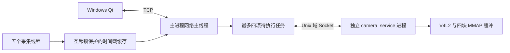

# 采集通信与相机进程架构

## 应用与进程划分

面向厂区室内低速巡检辅助观察与停靠监测原型，传感器持续采样，图像按请求获取。相机涉及设备映射和图像内存，将其独立为子进程，目的是隔离相机用户态故障并允许独立恢复。i.MX6ULL 是单核，增加进程不等于增加 CPU 算力。当前没有运动控制、安全制动或实际厂区上线。

板端主进程运行网络主线程与五个周期采集线程，共 6 个线程。客户端连接后通过 `posix_spawn` 创建单线程相机子进程；断线后回收子进程。仍只接待一个客户端。相机创建失败时保持传感器与 PING 服务，相机请求返回兼容的错误。

| 文件 | 职责 |
| --- | --- |
| `tcp_ping_server.c` | TCP 解析与统一发送；poll 监听客户端、信号通知、相机 IPC |
| `sensor_sampler.c` | 五个采集线程、完整快照、时效与失败检查、采样停止及 join |
| `camera_worker.c` | 主进程 IPC 代理：任务排队、部分收发、完整图像校验、超时与重启策略 |
| `process_manager.c` | socketpair、posix_spawn、FD 传递、waitpid、停止超时升级 |
| `ipc_protocol.c` | 固定 40 字节大端消息头的编解码 |
| `camera_service.c` | 子进程入口，串行执行 START / FRAME / STOP / CAPTURE |
| `camera_capture.c` | 子进程独占 V4L2、四块 MMAP、JPEG 复制及设备释放 |

## 传感器采集

每个设备只有一个采集线程。设备 I/O 不持有缓存锁，完成后短暂加锁发布完整样本、错误、成功序号和 `CLOCK_MONOTONIC` 完成时间。网络线程复制快照后在锁外格式化与发送。工作线程栈各为 256 KiB。

| 设备 | 读取后等待 | 快照最大年龄 |
| --- | --- | --- |
| AP3216C | 1000 ms | 3000 ms |
| ICM20608 | 1000 ms | 3000 ms |
| DHT11 | 3000 ms | 7000 ms |
| SR04 | 500 ms | 2000 ms |
| SR501 | 500 ms | 2000 ms |

DHT11 的微秒接收会短暂屏蔽中断，SR04 依赖回波 IRQ 时间戳，因此二者保留进程内时序互斥锁。其他设备独立采集；此锁不约束外部诊断程序直接读取设备。

READ 返回最新有效缓存。首次未就绪、最新读取失败、缓存过期时返回原有 `ERR <id> <设备>_READ`；不将旧成功样本冒充新成功样本。各传感器不是硬件同步快照，AP 三项 sysfs 属性仍顺序读取。当前外部协议不携带采样时间，请求编号也不是采样序号。

## IPC 与有界资源

使用 `socketpair(AF_UNIX, SOCK_STREAM | SOCK_CLOEXEC, ...)` 建立双向字节流。40 字节头依次包含 magic、版本、类型、连接代号、进程代次、请求编号、操作或结果码、载荷长度、宽、高，字段均为 32 位大端整数。不直接发送 C 结构体或进程内指针。

父进程使用非阻塞 FD 与 poll，保留头部、载荷的收发偏移。子进程同样处理短读短写。父进程校验 READY、连接与进程代次、请求编号、消息类型、长度上限、图像尺寸及 JPEG 首尾标记。完整收到 JPEG 后才向 Qt 发送头和载荷；子进程发送半张图后退出时，父进程丢弃半帧并返回错误。首尾标记校验不等于 JPEG 解码，解码仍由 Qt 完成。

待执行任务最多 4 项，同时最多 1 项在途任务；满时立即返回 `CAMERA_BUSY`。父进程只保留 1 项完整回复，消费前不提交下一任务。队列均由网络主线程独占，不再使用相机线程互斥锁或条件变量。采集线程仍使用互斥锁和条件变量。

每张 JPEG 上限 4 MiB。子进程持有一份采集结果，父进程持有一份正在接收或发送的结果，两进程合计最多两份独立 JPEG，即 8 MiB；不包含四块 V4L2 MMAP、内核 Socket 缓冲、线程栈及其他对象。子进程发送后释放自己的结果，父进程完整接收后持有独立内存，并在 TCP 发送完成、失败或断线时释放。

TCP 协议保持兼容：文本按行、JPEG 按长度、请求编号匹配。网络主线程连续发送完整 JPEG，再发送下一消息，每条回复共用 5 秒期限。慢客户端仍可能推迟后续传感器回复，但不阻塞后台采样；进程拆分不消除单条 TCP 字节流的顺序限制。

Qt 收到已知的完整相机错误时结束图像业务，保留 TCP 与已有传感器数据；SR501 自动刷新继续。请求等待为 20 秒，收到 JPEG 头后载荷限时 8 秒，覆盖板端恢复与发送期限。协议损坏及半帧超时仍断线，具体错误处理见 [协议说明](protocol.md)。

## 创建、恢复与退出

`posix_spawn` 用于已有采集线程的父进程，避免自行 fork 后执行复杂业务。子进程只继承标准流及 FD 3 的 IPC。监听、客户端、信号管道与传感器设备均原子设置 CLOEXEC，子进程不持有父进程的网络或设备 FD。子进程重置终止信号屏蔽集，并以 `PR_SET_PDEATHSIG(SIGKILL)` 加父 PID 复查处理父进程突然退出的竞态。

默认从主程序所在目录寻找 `camera_service`；可用 `VEHICLE_CAMERA_SERVICE` 指定绝对路径。相机不会继承上个连接的预览状态。

| 条件 | 策略 |
| --- | --- |
| 启动握手 | 3 秒未收到有效 READY 则停止该子进程 |
| 图像任务 | 从提交 IPC 起最多 10 秒，包含执行和完整回复 |
| IPC 断开、非法回复、任务超时、子进程退出 | 丢弃部分图像；使在途和排队请求逐项返回 `CAMERA_START` 错误 |
| 自动重启 | 等待至少 500 ms，旧进程回收且失败回复消费后重建；每连接最多初次启动加两次重启 |
| 预览恢复 | 新进程默认关闭预览，客户端需重新发送 PREVIEW_START |
| 断线或服务退出 | 禁止重启，关闭 IPC、发送 SIGTERM；500 ms 后仍存活则 SIGKILL，再以 waitpid 回收 |

SIGINT / SIGTERM / SIGCHLD 由主线程接收。信号处理器只设置停止标志或写入非阻塞管道，不加锁、free 或 waitpid。正常上下文使用 WNOHANG 回收子进程，停止时广播并 join 全部采集线程。部分传感器线程创建失败仍回滚已创建线程。

相机停止等待最多约 1.5 秒。若驱动进入不可中断内核等待，SIGKILL 也不能保证立即退出；保留其 PID，禁止继续创建新相机进程，并在后续主循环回收。采集线程进入永久阻塞的驱动读取时，也不能保证主程序限时退出。本方案不承诺恢复内核故障，也没有主进程崩溃自动拉起机制。

## 验证

Windows CTest 检查 Qt 与采集线程，ARM 静态分析检查目标头文件兼容性。Linux 使用真实主程序、真实相机子程序和模拟设备，检查协议、FD 隔离、队列满、子进程崩溃、半帧/非法 IPC、握手/任务超时、有限重启、父进程退出及断线回收。命令见 [测试说明](../tests/README.md)，实际完成范围见 [验证记录](validation.md)。

此前多线程版本的板端结果仍是历史证据；新增进程版本必须重新做匹配工具链链接、板端资源与业务验收。
