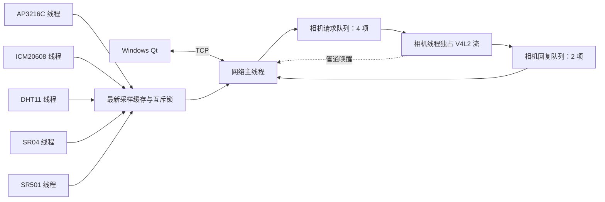

# 架构与线程资源管理

## 线程分工

板端采用一个进程：网络主线程、五个周期传感器线程，以及当前连接专用的一个相机线程。空闲时共 6 个业务线程，连接后共 7 个；仍只服务一个客户端。工作线程栈各配置为 256 KiB，不随请求数量增加线程。

`sensor_sampler.c` 管理传感器线程、最新结果、错误、完成时间和停止状态。`camera_worker.c` 管理相机线程和有界队列。`tcp_ping_server.c` 负责命令解析、读取快照、提交相机任务和统一网络发送。原有五个读取模块与 `camera_capture.c` 继续负责具体设备接口。

## 传感器采样与共享缓存

每个设备只有一个采集线程，启动后即采样，不依赖 Qt 是否正在请求该设备。每次设备读取结束后，再通过条件变量等待下一周期，避免补发积压采样或忙循环。

DHT11 驱动的微秒接收阶段会屏蔽本 CPU 中断，SR04 又依赖 GPIO 回波中断时间戳。在单核 i.MX6ULL 上，这两个读取共用独立的 `timing_mutex`，避免本服务内二者重叠；其他设备仍可并发。时序锁只保护这两个设备的物理读取，不阻塞网络访问缓存。此锁只协调本服务，外部进程直接读取设备不受其保护。

| 设备 | 读取后等待 | 快照最大年龄 |
| --- | --- | --- |
| AP3216C | 1000 ms | 3000 ms |
| ICM20608 | 1000 ms | 3000 ms |
| DHT11 | 3000 ms | 7000 ms |
| SR04 | 500 ms | 2000 ms |
| SR501 | 500 ms | 2000 ms |

`READ_*` 返回最近一次读取的有效快照，已不再临时触发一次设备采样。请求编号仍用于网络请求匹配，不能当作采样序号。首次尚未就绪、最新采样失败、快照过期时，继续返回兼容原协议的 `ERR <id> <设备>_READ`，不会把旧成功值当作新成功值。

缓存包含完整样本、成功序号和读取完成的 `CLOCK_MONOTONIC` 时间。设备 I/O 在锁外执行；采样结束后短暂加锁发布完整结果，网络线程同样在锁内复制快照，再在锁外格式化和发送。各设备独立采样，AP 的三个 sysfs 属性也仍为顺序读取，不承诺硬件同时刻快照。

当前文本协议没有携带采样时间，Qt 的过期计时仍针对收到回复的时间。反复读取同一缓存不能证明硬件持续产生新样本；服务内部的采样失败和年龄检查负责限制旧值。

## 相机与网络发送

相机线程按 FIFO 处理 START、FRAME、STOP、CAPTURE，独自打开、读取和关闭 V4L2 流；其他线程不会在取帧过程中关闭映射或设备。相机沿用 640×480/MJPEG、4 块 MMAP 缓冲和取较新帧的实现。

请求队列最多 4 项，满时立即返回 `ERR <id> CAMERA_BUSY`。回复队列最多 2 项，满时相机线程睡眠等待网络消费，避免不断分配图像。队列操作持有互斥锁，等待条件变量时释放锁；设备操作与管道通知在锁外。

JPEG 由相机线程复制到独立内存，成功入队后交给回复队列，出队后交给网络主线程；发送完成或失败后释放。队列、相机线程和网络线程持有的独立 JPEG 副本合计最多 3 份，每份上限 4 MiB；这不包含 V4L2 映射和内核 socket 缓冲。

只有网络主线程调用 `send`。它发送完 JPEG 文本头和全部载荷后，才发送下一条回复，传感器文本不会插进图片。socket 使用非阻塞模式，每条回复共用 5 秒发送期限；背压等待每至多 100 ms 检查退出标志。慢客户端可能延迟后续回复，但不会阻塞后台传感器采样；一条 TCP 字节流仍需顺序传输。

异步取图期间，PING 和传感器回复可以先返回；相机命令自身保持 FIFO。保持一次一个业务请求的现有 Qt 可以继续使用；以后若允许 Qt 同时发多种业务，还需调整其等待状态管理。

## 停止、断线与创建失败

工作线程继承屏蔽 SIGINT/SIGTERM 的信号集，终止信号由网络主线程处理。处理器只设置 `sig_atomic_t` 标志并写入非阻塞唤醒管道。锁操作、释放内存和 `pthread_join` 均在正常线程上下文执行。Linux 周期等待使用单调时钟条件变量；Windows 仅为本机模拟测试使用 Winpthreads 相对等待接口。

断线后，网络线程先关闭连接的收发方向，通知相机线程停止、丢弃未执行任务并唤醒队列等待；相机线程结束当前操作、关闭流，然后由主线程 join 并释放剩余回复。完成回收后才接待下一连接，旧任务不会向复用的 socket 描述符发送数据。

服务退出时，还会通知全部传感器线程停止并广播条件变量，join 已创建的全部线程，随后销毁同步对象、缓存和管道。线程创建中途失败时回收已启动线程；相机线程创建失败时直接关闭当前连接。

不使用 `pthread_cancel` 强行中断设备操作。正常退出需要等待已进入的驱动读取或 ioctl 返回；相机等待帧已有 3 秒总期限，硬件异常或第三方驱动永久阻塞仍可能延长 join。SIGKILL 不会执行用户态清理。

| 资源 | 所有者与回收方式 |
| --- | --- |
| 监听 socket、客户端 socket、唤醒管道 | 网络主线程关闭；管道保留到工作线程 join 完成 |
| 传感器快照、错误和停止标志 | sampler 互斥锁保护；destroy 在 join 后释放 |
| DHT11/SR04 微秒时序 | 独立时序锁覆盖完整设备读取；获取时序锁后重新检查停止状态 |
| 传感器设备文件 | 原读取模块在各自采集线程中打开、读取和关闭 |
| V4L2 流、设备 FD、MMAP 映射 | 相机线程独占；STOP、取图失败或线程退出时关闭 |
| 相机请求/回复队列 | worker 互斥锁与条件变量保护，容量固定 |
| 独立 JPEG | 相机 → 队列 → 网络，所有权转移，退出时释放剩余副本 |
| pthread 句柄及同步对象 | 创建方记录，停止后逐个 join，再销毁同步对象 |

SysV 的 PID/starttime 管理继续使用同一服务进程。当前没有崩溃自动拉起、多客户端并发或 Qt 工作线程改造。

## 验证范围

线程测试执行真实 sampler/worker 源码，覆盖设备同时进入、慢设备隔离、快照一致性、失败及过期、逐个线程创建失败、相机队列满和停止清理。Linux 网络模拟测试还覆盖协议分帧、重复连接线程/FD 回收、发送期限和信号退出，命令见 `tests/README.md`。

本次本地结果见 `validation.md`。原单线程版本的实机、CPU、RSS 与帧率记录不能直接作为多线程版本的结果。
